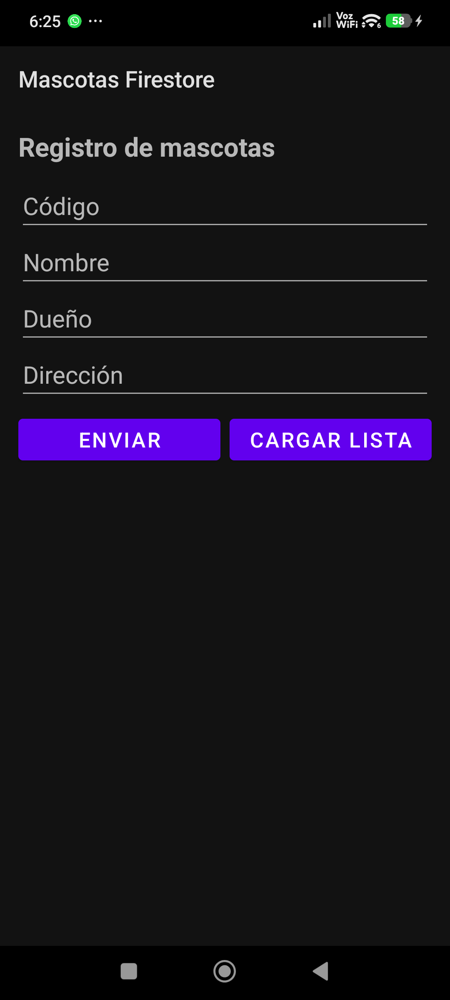
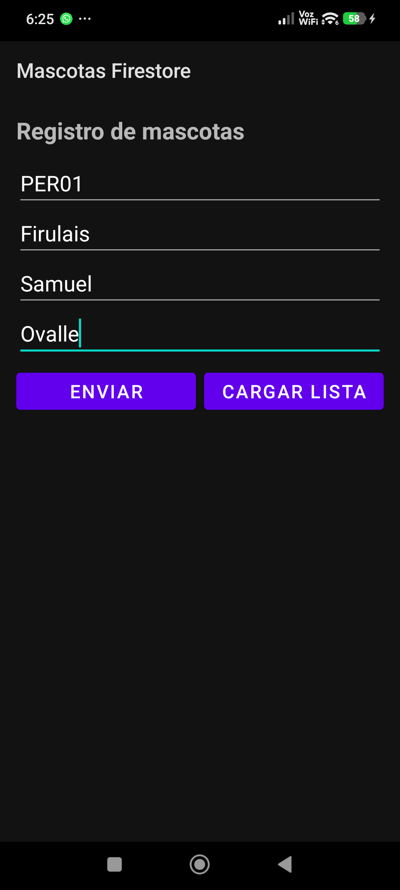
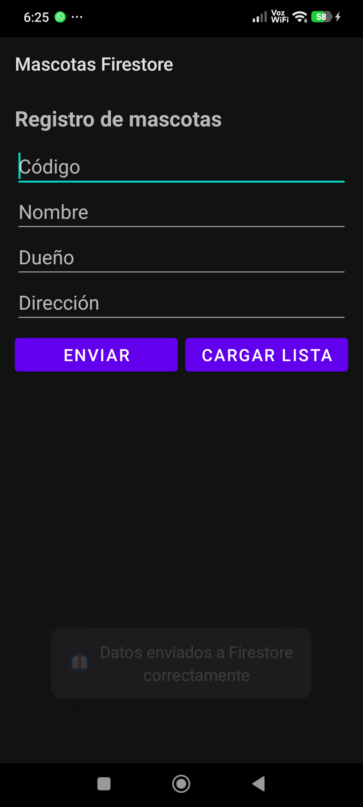
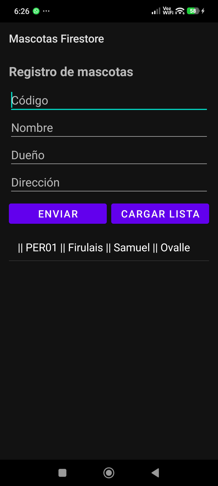
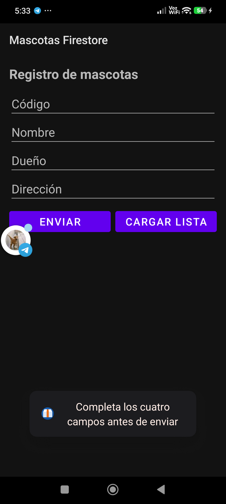

# Informe Unidad 3 — Firebase en Android

**Autor:** Samuel Eduardo Bugueño Vega
**Fecha:** 22 de noviembre de 2026
**Proyecto de Firebase:** `mascotas-firestore-u3`
**Asignatura:** Programación Android (IEI-093)
**Actividades:** 3.1 Manejo de base de datos externa – Firebase · 3.2 Desarrollo de funcionalidades avanzadas con Firebase
**Proyecto:** `ProyectoFirebase` — paquete `com.stomas.proyectofirebase`
**Entorno:** Android Studio, Java 17, Gradle 8.14.6, compileSdk 34, Cloud Firestore

---

## 1. Actividad 3.1 — Base de datos externa con Firebase

### 1.1 Investigación

**¿Qué es Firebase?**
Firebase es una plataforma de servicios de backend (BaaS) de Google. Entrega infraestructura ya
operativa para que la app no tenga que implementar servidores propios: base de datos en tiempo real
(Realtime Database), base de datos documental (Cloud Firestore), autenticación de usuarios
(Authentication), almacenamiento de archivos (Cloud Storage), notificaciones push (Cloud Messaging),
analítica de uso (Analytics), hosting web (Hosting) y lógica en el servidor (Cloud Functions).

**¿Cómo se conecta una aplicación Android a Firebase?**
1. Crear un proyecto en la consola de Firebase (`console.firebase.google.com`).
2. Registrar la app Android indicando el nombre del paquete, que debe coincidir exactamente con el
   `applicationId` del proyecto (`com.stomas.proyectofirebase`). Para Authentication con proveedores
   federados además se registra la huella SHA-1 de la firma.
3. Descargar `google-services.json` y ubicarlo en la carpeta `app/` del proyecto.
4. Declarar el plugin de Google Services en Gradle: en el `build.gradle` del proyecto
   `id 'com.google.gms.google-services' version '4.4.3' apply false`, y en el `build.gradle` del
   módulo `app` el mismo plugin sin versión, junto con las dependencias de Firebase y el BOM que
   alinea sus versiones.
5. Sincronizar Gradle. El SDK se inicializa solo: el plugin genera valores de recursos a partir del
   JSON y la librería `firebase-common` los lee al arrancar la app, sin código de inicialización
   manual en `MainActivity`.
6. En la consola, crear la base de datos (Firestore) y ajustar las reglas de acceso.

**¿Qué tipos de datos se pueden enviar a Firebase?**
En Cloud Firestore un documento es un mapa de campos, con estos tipos: texto (`String`), números
enteros y decimales (`long`/`double`), booleanos, fecha y hora (`Timestamp`), coordenadas
(`GeoPoint`), referencia a otro documento (`DocumentReference`), arreglos (`List`), mapas anidados
(`Map`) y datos binarios (`Blob`/`byte[]`). El documento completo no puede superar 1 MiB y no admite
arreglos dentro de arreglos. En Realtime Database el modelo es un árbol JSON, por lo que solo se
envían objetos, arreglos, textos, números y booleanos.

**¿Qué es el protocolo MQTT?**
MQTT (Message Queuing Telemetry Transport) es un protocolo de mensajería del tipo publicador /
suscriptor pensado para dispositivos con poco ancho de banda y energía. Un *broker* central recibe
los mensajes y los entrega a quienes están suscritos a un *tópico*. Trabaja sobre TCP en los puertos
1883 (sin cifrar) y 8883 (TLS), y define tres niveles de calidad de servicio: QoS 0 (como máximo una
vez), QoS 1 (al menos una vez) y QoS 2 (exactamente una vez). Es el estándar de facto en IoT.

**¿Cómo se envían datos a través de ese protocolo?**
Se necesita un cliente MQTT en el dispositivo, por ejemplo Eclipse Paho o HiveMQ para Android. El
cliente se conecta al broker con un identificador y credenciales, publica en un tópico con
`publish(topico, payload, qos, retained)` y se suscribe con `subscribe(topico, qos)`. El payload es
texto libre, por lo que en la práctica se envía un JSON con las lecturas del sensor.

**¿Qué aplicaciones se pueden diseñar uniendo Firebase con MQTT?**
Sistemas de monitoreo y control: huerto o invernadero inteligente (sensores de humedad y temperatura
que publican por MQTT, un servicio intermedio guarda las lecturas en Firestore y la app las muestra),
domótica, telemetría de vehículos, control de riego, medidores de consumo eléctrico y agricultura de
precisión. La regla general es MQTT para el tramo dispositivo → servidor, porque es liviano y
bidireccional, y Firebase para el tramo servidor → app, porque aporta persistencia, autenticación y
consultas.

**¿Qué es un WebSocket?**
Es un protocolo de comunicación bidireccional y persistente sobre una única conexión TCP. Se abre con
un handshake HTTP (`Upgrade: websocket`) y, una vez establecido, cliente y servidor envían tramas en
cualquier momento sin volver a negociar. Firestore usa esta familia de canales para sus escuchas en
tiempo real: por eso una app puede recibir cambios sin recargar la pantalla ni hacer sondeos
periódicos.

### 1.2 Modelo de datos que usé en la app

Elegí **Cloud Firestore** como base de datos, en modo de producción, con reglas abiertas solo
para la etapa de pruebas de la asignatura. Diseñé la colección así:

```
mascotas (colección)
└── {idAutomático} (documento)
    ├── codigo:    string
    ├── nombre:    string
    ├── dueno:     string   (el docente la escribe "dueño"; Firestore admite tildes,
    └── direccion: string    se dejó sin tilde para evitar problemas de codificación)
```

Equivalencia entre los ejemplos de la pauta (JavaScript, API web) y el código Android entregado:

| Ejemplo de la pauta | Implementación en `MainActivity.java` |
| --- | --- |
| `firebase.database()` | `FirebaseFirestore.getInstance()` |
| `ref('users/' + userId).set({...})` | `db.collection("mascotas").add(mascota)` — devuelve el ID automático |
| `update(updates)` con dos rutas | No usado: escribir en dos colecciones es innecesario con un solo documento |
| `push().key` | `DocumentReference.getId()` del `addOnSuccessListener` |
| Lectura de datos | `db.collection("mascotas").get()` + `QueryDocumentSnapshot` |

Comparé la tabla anterior con lo que implementé: la pauta muestra la sintaxis de la API web, que se
ejecuta en un navegador. En Android el flujo es el mismo (referencia → escritura → lectura), pero
cambié el objeto de acceso (`FirebaseFirestore` en lugar de `firebase.database()`), el tipo de
resultado (`Task` en lugar de promesa) y acepté que las llamadas son asíncronas y me devuelven
`onSuccess`/`onFailure` en callbacks, no en la línea siguiente.
### 1.3 Preguntas de cierre — Actividad 3.1

**¿Qué aprendiste de la actividad realizada?**
Que lo importante pasa antes del código: el paquete de la app y el `google-services.json` tienen que
coincidir exacto, si no el proyecto no compila. Y que la base responde después, así que la pantalla
se actualiza en el callback.

**¿En qué ámbitos puedes utilizar o aplicar lo realizado?**
En cualquier app donde varias personas necesiten los mismos datos sin tener un servidor propio:
inventario, pedidos, asistencia o las lecturas de un huerto.

**¿Qué aprendiste de Firebase y los conceptos estudiados?**
Que Firebase son varios servicios y hay que elegir cuál conviene: Firestore para registros, Storage
para archivos, Authentication para entrar. Y que MQTT es lo típico de los sensores, mientras que
Firestore me da el tiempo real sin que yo vea el WebSocket por debajo.

---

## 2. Actividad 3.2 — Funcionalidades avanzadas con Firebase

### 2.1 Procedimiento que ejecuté

Creé el proyecto Android en Android Studio con lenguaje Java y el paquete
`com.stomas.proyectofirebase`. Después conecté el proyecto a Firebase desde la línea de comandos:
primero autentiqué mi cuenta con

```bash
firebase login
```

y creé el proyecto en Firebase:

```bash
firebase projects:create mascotas-firestore-u3 --display-name "Mascotas Firestore U3"
```

Registré la app Android con el nombre *Mascotas Firestore* y el paquete real de la app:

```bash
firebase apps:create ANDROID "Mascotas Firestore" --package-name com.stomas.proyectofirebase -P mascotas-firestore-u3
```

Descargué la configuración real de esa app al archivo que Gradle espera, `app/google-services.json`:

```bash
firebase apps:sdkconfig ANDROID 1:628737010825:android:7efabc4d5251d7d49f2a58 -P mascotas-firestore-u3 --out app/google-services.json
```

Por último desplegué las reglas de Firestore del proyecto:

```bash
firebase deploy --only firestore:rules -P mascotas-firestore-u3
```

Con el proyecto ya conectado, configuré Gradle (dejé el BOM de Firebase administrando las
versiones):

```gradle
// build.gradle (proyecto)
plugins {
    id 'com.android.application' version '8.13.2' apply false
    id 'com.google.gms.google-services' version '4.4.3' apply false
}

// app/build.gradle
plugins {
    id 'com.android.application'
    id 'com.google.gms.google-services'
}
dependencies {
    implementation platform('com.google.firebase:firebase-bom:32.6.0')
    implementation 'com.google.firebase:firebase-firestore'
    implementation 'com.google.firebase:firebase-analytics'
}
```

En `activity_main.xml` diseñé cuatro `EditText` (`edtCodigo`, `edtNombre`, `edtDueno`, `edtDireccion`),
dos `Button` conectados por `android:onClick` y un `ListView` (`listaMascotas`).

En `MainActivity.java` implementé `enviarDatos(View)` para escribir con `add(mascota)` y mostrar un
`Toast` de confirmación, y `CargarLista(View)`, que delega en `cargarListaFirestore()`: esa función
lee la colección con `get()`, arma una línea por documento y la publica en el `ListView` con
`ArrayAdapter` sobre `android.R.layout.simple_list_item_1`.

Para la etapa de pruebas dejé estas reglas de Firestore:

```
rules_version = '2';
service cloud.firestore {
  match /databases/{database}/documents {
    match /mascotas/{documento} {
      allow read, write: if true;   // solo para pruebas de la asignatura
    }
  }
}
```

> Advertencia: `allow read, write: if true` deja la base abierta a cualquiera que conozca el proyecto.
> Sirve para la demostración, no para producción; el paso siguiente es exigir `request.auth != null`.

### 2.2 Diferencias respecto del paso a paso de la pauta

| Punto de la pauta | Decisión tomada | Motivo |
| --- | --- | --- |
| `firebase-firestore:23.0.0` fijado a mano | Lo dejé sin versión, administrado por el BOM 32.6.0 | Fijar una versión de 2021 junto al BOM crea dos fuentes de verdad y conflictos de dependencias |
| `com.android.support:multidex:1.0.3` | Lo omití | Es la biblioteca antigua, incompatible con AndroidX, y con `minSdk 24` la multidex es nativa |
| Cambiar `compileSdkVersion` de 33 a 34 | Usé `compileSdk 34` desde el inicio | Evita el error de compilación que la pauta corrige a mitad de camino |
| `Toast` con texto literal | Usé recursos en `strings.xml` | Permite traducir y centralizar los mensajes |
| Sin validación del formulario | Validé que los cuatro campos tengan contenido | Evita documentos con campos vacíos, que luego se ven como filas incompletas |

### 2.3 Funcionalidades avanzadas: estado dentro de la entrega

La descripción de la actividad menciona autenticación, almacenamiento de archivos, notificaciones
push y analítica. El paso a paso entregado por el docente solo desarrolla Firestore, y eso es lo que
implementé y verifiqué con compilación real. Estado por funcionalidad:

- **Cloud Firestore (implementado):** escritura y lectura de la colección `mascotas`.
- **Analytics (incluido):** la dependencia `firebase-analytics` queda activa; los eventos se registran
  en la consola sin código adicional.
- **Authentication (documentado, no implementado):** requiere registrar la huella SHA-1 en la consola
  y un formulario de acceso; queda como siguiente paso del proyecto.
- **Cloud Storage (documentado, no implementado):** requiere habilitar el *bucket* y permisos de
  lectura de archivos; se aplica a la foto de la mascota o de la planta.
- **Cloud Messaging (documentado, no implementado):** requiere un servidor o Cloud Function que emita
  la notificación; se aplica a la alerta de heladas del proyecto de huerto.

### 2.4 Preguntas de cierre — Actividad 3.2

**¿Qué aprendiste de la actividad realizada?**
Que lo difícil no es guardar los datos, es dejar bien la configuración: plugin, JSON, versiones y
reglas. Y que para refrescar la lista tengo que volver a consultar la base.

**¿En qué ámbitos puedes utilizar o aplicar lo realizado?**
En registros donde varias personas tienen que ver lo mismo al instante: bodega, catálogo,
asistencia o los riegos de un huerto.

**¿Pudiste realizar toda la actividad con los ejemplos entregados?**
Sí. Solo cambié tres cosas: dejé la versión de Firestore al BOM, saqué la librería vieja de multidex
y usé `compileSdk 34` desde el principio.

---

## 3. Verificación realizada y evidencias

Autentiqué la CLI con mi cuenta `samueleduardobuguenovega@gmail.com` y trabajé contra el proyecto
`mascotas-firestore-u3` (consola: `https://console.firebase.google.com/project/mascotas-firestore-u3/overview`),
con la app Android registrada con el paquete `com.stomas.proyectofirebase` y el app id
`1:628737010825:android:7efabc4d5251d7d49f2a58`. La base Firestore quedó en la base `(default)`,
ubicación `southamerica-east1`, edición STANDARD, tipo `FIRESTORE_NATIVE`, con las reglas
desplegadas con `firebase deploy --only firestore:rules`: lectura y escritura abiertas solo en la
colección `mascotas`, el resto cerrado.

| Verificación | Resultado | Evidencia |
| --- | --- | --- |
| Compilación `./gradlew assembleDebug` | BUILD SUCCESSFUL, APK de 9,2 MB | `app/build/outputs/apk/debug/app-debug.apk` |
| Proyecto y app registrados con la CLI | Proyecto `mascotas-firestore-u3`, paquete `com.stomas.proyectofirebase`, app id `1:628737010825:android:7efabc4d5251d7d49f2a58` | comandos `firebase projects:create` y `firebase apps:create` |
| `google-services.json` real descargado con `firebase apps:sdkconfig` | `project_id: mascotas-firestore-u3`, paquete coincidente | `app/google-services.json` |
| Reglas desplegadas con `firebase deploy --only firestore:rules` | Lectura y escritura abiertas solo en `mascotas`, resto cerrado | `firestore.rules` |
| Instalación en el teléfono físico con `adb install -r` | Primero rebotó con `INSTALL_FAILED_USER_RESTRICTED` porque rechacé por error el aviso del sistema; al repetirla y aceptar el aviso, terminó en Success. Dispositivo modelo 23049PCD8G, Android 15 (API 35), pantalla 1080x2400 | salida de `adb install -r` |
| Escritura real desde la app | El registro `codigo=PER01`, `nombre=Firulais`, `dueno=Samuel`, `direccion=Ovalle` fue aceptado por Firestore; el logcat mostró `Documento creado: m5oinNLksQxLq98VBvfE` y la app mostró "Datos enviados a Firestore correctamente" | logcat y `docs/evidencias/03_envio_confirmado.png` |
| Lectura real desde la app | Al presionar *Cargar lista*, el `ListView` mostró la línea `\|\| PER01 \|\| Firulais \|\| Samuel \|\| Ovalle`, leída desde Firestore | `docs/evidencias/04_lista_cargada.png` |
| Validación del formulario | Con los campos vacíos la app mostró "Completa los cuatro campos antes de enviar" y no escribió nada en la base | `docs/evidencias/05_validacion_campos_vacios.png` |
| Limpieza de la prueba por API REST | Creé por API REST un documento de prueba `codigo=REST01` y luego lo eliminé; la colección quedó con un solo documento, el enviado desde la app | colección `mascotas` en la consola |

**Nota de proceso.** Antes de tener el proyecto real la app usaba un `google-services.json` de
plantilla y Firestore respondía `PERMISSION_DENIED on resource project
proyecto-firebase-placeholder`. Ese error desapareció al conectar el proyecto real
`mascotas-firestore-u3`.

**Para reproducir la demostración:**

1. Confirmar que `app/google-services.json` sea el del proyecto `mascotas-firestore-u3`.
2. Ejecutar la app, completar los cuatro campos y presionar *Enviar*.
3. Presionar *Cargar lista* y ver el registro agregado.
4. Verificar el mismo documento en la consola, en **Firestore Database → Datos → mascotas**.

---

## 4. Prueba final en el teléfono

Con el APK de 9,2 MB instalado en el teléfono físico (modelo 23049PCD8G, Android 15 / API 35,
pantalla 1080x2400) con `adb install -r`, ejecuté la prueba completa:

1. Abrí la app y dejé el formulario vacío para fotografiar el estado inicial.



2. Escribí los datos de la mascota: `codigo=PER01`, `nombre=Firulais`, `dueno=Samuel`,
   `direccion=Ovalle`.



3. Presioné *Enviar* y la app mostró "Datos enviados a Firestore correctamente"; el logcat confirmó
   `Documento creado: m5oinNLksQxLq98VBvfE`.



4. Presioné *Cargar lista* y el `ListView` mostró la línea `|| PER01 || Firulais || Samuel || Ovalle`,
   leída desde Firestore.



5. Dejé los campos vacíos y presioné *Enviar*: la app mostró "Completa los cuatro campos antes de
   enviar" y no escribió nada en la base.



---

## Anexo — Repaso final del material: necesidad técnica y componente

| Necesidad | Componente |
| --- | --- |
| Subir la foto en alta resolución de la tomatera | Cloud Storage |
| Avisarme al móvil si hay riesgo de heladas | Cloud Messaging |
| Ver la humedad actual cambiando en pantalla sin recargar | Realtime Database |
| Entrar a la app con mi correo electrónico | Authentication |
| Guardar el registro estructurado de riegos de cada mes | Cloud Firestore |
